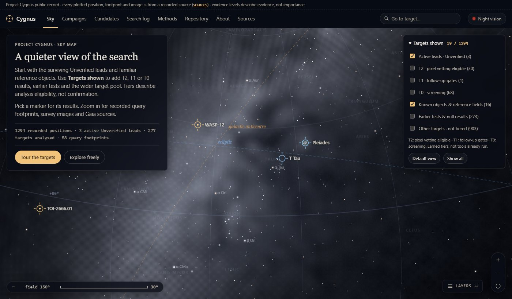

# Project Cygnus / Astraea

_made with love by [maria](https://github.com/mariyaholic)_

A little astronomy data-forensics lab that digs back through public archive data (TESS, Kepler, Gaia, WISE, ZTF,
Legacy Surveys and a bunch more) looking for signals the standard survey pipelines might have missed - and then
tries really hard to explain every one of them away before calling it a lead. Everything runs on free, anonymous
archives. You don't need any login, telescope time, payment, whatever. Just Python!

Nothing in here is an established discovery. Right now it looks like this:
```
TOI-224.01    Unverified lead    T2    source/orbit gates still open
TOI-2666.01   Unverified lead    T2    source/orbit gates still open
TOI-3500.02   Unverified lead    T2    source/orbit gates still open
TOI-6695.01   retracted                 a published TTV transit, not a new event
TOI-7610.01   retracted                 a Gaia SB1 stellar binary, and localization failed
```



## Look at it

The public record lives at **[cygnus-sky.pages.dev](https://cygnus-sky.pages.dev)**. It opens on a sky map of every
recorded target, and u can zoom from the whole sky down to the query footprints, survey images and Gaia sources
around each one. The campaigns, candidate dossiers, search log and methods are all there too. Every plotted
position, footprint and image comes from a recorded source.

For the up-to-date state of each lead and what's still left to prove or disprove, read
[`docs/STATUS.md`](docs/STATUS.md).

## How to use it

- **Run one target:** This is the normal loop, and u never write analysis code for it. It claims a target, runs it
  and writes the report:
  ```sh
  python -m cygnus.campaign queue                       # rank, target, state, positive control, review
  python -m cygnus.campaign new --next                  # claims the top unclaimed target -> campaigns/<slug>.yaml
  python -m cygnus.campaign run campaigns/<slug>.yaml   # 1-5 min, resumable, just rerun it after a failure
  python -m cygnus.campaign report campaigns/<slug>.yaml
  python -m pytest -q                                   # must pass
  ```
- **Pick something else:** `new --from-queue TOI-2423.01` for a named target, `new --planet "WASP-12 b"` for any
  known planet (every predicted transit becomes a positive control), or `new --manual NAME --tic N --ra DEG
  --dec DEG --t0 BJD --source "..."` for anything else. Never edit a generated spec's numbers by hand. If a value
  is wrong, fix the source and generate the spec again
- **Run lots of targets:** `python -m cygnus.batch` drives the same loop for tens to hundreds of targets, so every
  campaign it makes is identical to one made by hand
- **Use Colab:** the notebooks in `notebooks/` run the tiered lead pursuit and the reusable second stage on Google
  Colab. Finished runs get indexed in `docs/colab_runs/` and `storage/locations.jsonl`
- **Publish something:** stuff only becomes public through `publish/collections/*.json`. Run
  `python -m cygnus.publish check` before `build`, and never edit the templates to add content
- **Rebuild the sky map:** `python design-system/mockups/build_explorer.py`. new catalogue fetches go through
  `fetch_sky_data.py` so their provenance gets recorded

The full procedure, with the review rules every lead has to pass, is in
[`docs/AGENT_RUNBOOK.md`](docs/AGENT_RUNBOOK.md).

**The evidence levels** - *Unverified lead* means an observed feature with an unfinished artifact audit,
*Vetted candidate* means it survived every test available, *Independently supported* means other data back it
up, and *Established* needs community confirmation. They describe evidence, not how exciting a target is.

## Settings

No credentials are needed. MAST, NASA Exoplanet Archive, VizieR, SIMBAD and the other services used are public
and anonymous. what u can set:
- `CYGNUS_SCRATCH`: where light curves and other downloads go (default `~/.cache/cygnus/scratch`). about 2 MB per
  TESS sector per target, and its always safe to delete
- `CYGNUS_LEDGER`: the SQLite provenance ledger (default `state/ledger.sqlite`, made on first use). on a machine
  other than the main workstation use ur own and name the run IDs in ur report so they can be merged later
- `campaigns/<id>.yaml`: the parameters of one analysis. steps are ledgered, resumable and regenerate the
  `sky_record.json` every analysis has to leave behind (the tests fail without it)
- `python -m cygnus.storage where`: tells u how the current machine reaches the shared Drive storage, since every
  harness gets there its own way

## Docs

| Read | For |
| --- | --- |
| [`AGENTS.md`](AGENTS.md) | The governing spec: principles, investigation protocol, evidence levels, dossier schema. Agents must follow it. |
| [`docs/STATUS.md`](docs/STATUS.md) | Current state, open decisions and known problems: the handoff note. Read second. |
| [`ANALYSIS_STACK.md`](ANALYSIS_STACK.md) | Architecture and the module register (what is built vs. designed). |
| [`DATA_SOURCES.md`](DATA_SOURCES.md) | Verified free archives and access tiers. |
| [`docs/STORAGE.md`](docs/STORAGE.md) | **Where stored data lives** (Drive folders, batch evidence, Colab runs): the committed index `storage/locations.jsonl` and `python -m cygnus.storage`, for every harness. |
| [`docs/COLAB_SYNC.md`](docs/COLAB_SYNC.md) | **Canonical Windows scheduler** for Colab tier marks and automatic repo notes. Reuse `\Cygnus-Colab-Sync`; do not create redundant schedules. |
| [`docs/HIGHER_TIERS_COLAB.md`](docs/HIGHER_TIERS_COLAB.md) | **Reusable second-stage notebook:** discover first-stage exports, select earned T2 targets, reuse exact products and resume by source/revision. No manual target list or automatic promotion. |
| [`docs/ANALYSIS_SUITE.md`](docs/ANALYSIS_SUITE.md) | Scope and limits of `src/cygnus/analysis/`. |
| [`docs/SUITE_EXPANSION.md`](docs/SUITE_EXPANSION.md) | 2026-09-26 inventory: adapter data the pipeline discards, code no test exercises, and the expanded desired suite (L0–L3 + new record checks). |
| [`docs/TEST_ARCHITECTURE_PLAN_DRAFT.md`](docs/TEST_ARCHITECTURE_PLAN_DRAFT.md) | Working-draft test plan and known gaps. |
| [`docs/PUBLISHING.md`](docs/PUBLISHING.md) | The public repository site and its publication boundary. |
| [`docs/AUTONOMY_STUDY.md`](docs/AUTONOMY_STUDY.md) | Historical autonomy study, with a current capability note. See STATUS and COLAB_SYNC for operations. |
| [`docs/AGENT_RUNBOOK.md`](docs/AGENT_RUNBOOK.md) | **Running a target through the pipeline** (any agent, any machine): five commands and the review rules; **batches** of many targets with `python -m cygnus.batch`. |
| [`docs/CAMPAIGNS.md`](docs/CAMPAIGNS.md) | Campaign specs and the runner: how analyses are run, ledgered and calibrated. |
| [`docs/SKY_RECORDS.md`](docs/SKY_RECORDS.md) | The `sky_record.json` every analysis must leave (enforced by tests). |
| [`design-system/mockups/README.md`](design-system/mockups/README.md) | The interactive sky explorer, the public site's home page: build, run, rules. |
| [`design-system/project/README.md`](design-system/project/README.md) | The Ad Astra design system (site look and copy rules). |

What's where:
```
src/cygnus/          Python package: ledger, candidate records, ingest, analysis, reporting, publish (site)
tests/               pytest suite (offline by default; `-m network` for live archive probes)
campaigns/           campaign specs and small campaign runs
reports/             campaign reports, search logs and derived outputs
docs/tier1_pack/     Tier-1 baseline pack manifests, name resolutions, search log
publish/             curated publication manifests for the public site
design-system/       Ad Astra design system source and the sky explorer
notebooks/           Colab reanalysis, batch and tiered lead notebooks; completed runs indexed in docs/colab_runs/
```

## Building it Yourself

You only need Python 3.10 or newer (3.12 is what the hosted runs use).

```sh
git clone https://github.com/mariyaholic/ad_astra && cd ad_astra
python -m venv .venv
.venv/bin/python -m pip install -e ".[test,site,campaign]"
.venv/bin/python -m pytest -q
```

On Windows the venv python is `.venv\Scripts\python`. The science extras are `mast`, `timing`, `imaging`, `moving`
and `analysis` if u want more than the campaign runner (see `pyproject.toml`). The tests are offline by default,
`-m network` runs the live archive probes.

Bulk archive data, the ledger (`state/`), scratch downloads and credentials are kept out of the repo on purpose
(`.gitignore`). The Tier-1 data products live in private cloud storage and this repo holds their manifests and
checksums, so every product can be fetched again from its public archive. The site in `build/` gets regenerated
with `python -m cygnus.publish build`.

## License

[Apache 2.0](LICENSE) © 2026 mariyaholic - Use it, change it, share it, just keep the license and notices with it.
And if u build something on top of it please credit this repo as the original source!

The data keep their own terms tho: Gaia-derived files (ESA/Gaia/DPAC) are CC BY-SA 3.0 IGO, and Pan-STARRS1,
2MASS, MAST/TESS and NASA Exoplanet Archive material need the acknowledgements recorded in
`design-system/mockups/data/PROVENANCE.json` and in each report.
