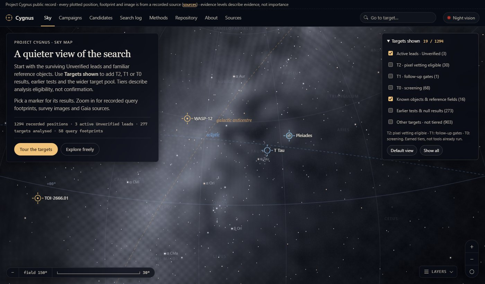

# Project Cygnus / Astraea

_made with love by [maria](https://github.com/mariyaholic)_

This is my little astronomy data-forensics lab. I dig back through public archive data (TESS, Kepler, Gaia, WISE, ZTF,
Legacy Surveys and a bunch more) looking for signals the standard survey pipelines might have missed - and then
I try really hard to explain every one of them away before calling it a lead. Everything runs on free, anonymous
archives. You don't need any login, telescope time, payment, whatever. Just Python!

Nothing in here is an established discovery. Right now it looks like this:
```
TOI-224.01    Unverified lead    T2    source/orbit gates still open
TOI-2666.01   Unverified lead    T2    source/orbit gates still open
TOI-3500.02   Unverified lead    T2    source/orbit gates still open
TOI-6695.01   retracted                 a published TTV transit, not a new event
TOI-7610.01   retracted                 a Gaia SB1 stellar binary, and localization failed
```



## Look at it

The public record lives at **[cygnus-sky.pages.dev](https://cygnus-sky.pages.dev)**. It opens on a sky map of every
recorded target, and you can zoom from the whole sky down to the query footprints, survey images and Gaia sources
around each one. The campaigns, candidate dossiers, search log and methods are all there too. Every plotted
position, footprint and image comes from a recorded source. I love how it feels to wander around in it, and I hope you enjoy it too.

For the up-to-date state of each lead and what's still left to prove or disprove, read
[`docs/STATUS.md`](docs/STATUS.md).

## How to use it

You only need Python. The normal loop is one target at a time: it claims a target from the queue, runs it
(1-5 minutes, resumable - if it fails just rerun it), writes the report, and the tests have to pass. You never
write analysis code for it. If the top of the queue is not the target you want, you can also ask for a named
target, a known planet, or anything else by hand. Batches of tens to hundreds of targets run through the same
loop, and the notebooks run it in Google Colab.

The five commands for the normal loop are in [the guide](https://mariyaholic.github.io/docs/ad_astra/#run).
The full procedure, with the review rules every lead has to pass, is in
[`docs/AGENT_RUNBOOK.md`](docs/AGENT_RUNBOOK.md).

**The evidence levels** - *Unverified lead* means an observed feature with an unfinished artifact audit,
*Vetted candidate* means it survived every test available, *Independently supported* means other data back it
up, and *Established* needs community confirmation. They describe evidence, not how exciting a target is.

## Everything else

The fine detail lives in [Ad Astra's guide](https://mariyaholic.github.io/docs/ad_astra/) on my site:

- [Run a campaign](https://mariyaholic.github.io/docs/ad_astra/#run) - the five commands and how a run is recorded
- [Pick a target](https://mariyaholic.github.io/docs/ad_astra/#pick) - named targets, known planets, manual entries, and batches
- [Run on Colab](https://mariyaholic.github.io/docs/ad_astra/#colab) - the notebooks and where finished runs are indexed
- [Publish results](https://mariyaholic.github.io/docs/ad_astra/#publish) - collections, the check and the build
- [Rebuild the sky map](https://mariyaholic.github.io/docs/ad_astra/#map)
- [Settings](https://mariyaholic.github.io/docs/ad_astra/#settings) - scratch space, the ledger, campaign specs and storage
- [Build from source](https://mariyaholic.github.io/docs/ad_astra/#build) - the science extras and what stays out of the repo
- [Repository layout](https://mariyaholic.github.io/docs/ad_astra/#repo) - what's where
- [Documents in the repository](https://mariyaholic.github.io/docs/ad_astra/#docs) - the full reading list

## License

[Apache 2.0](LICENSE) © 2026 mariyaholic - Use it, change it, share it, just keep the license and notices with it.
And if you build something on top of it please credit this repo as the original source!

The data keep their own terms though: Gaia-derived files (ESA/Gaia/DPAC) are CC BY-SA 3.0 IGO, and Pan-STARRS1,
2MASS, MAST/TESS and NASA Exoplanet Archive material need the acknowledgements recorded in
`design-system/mockups/data/PROVENANCE.json` and in each report.

Thank you for looking at my little corner of the sky. ♡
