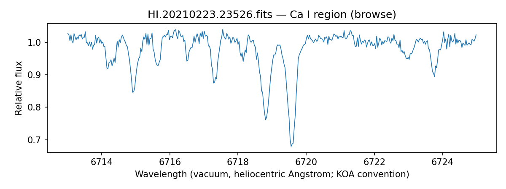

# Three-lead advancement — 2026-10-11

**Result: substantive new tests and archival products were obtained, but none of the three event interpretations has cleared the source/orbit requirements for a completed Tier 3 investigation.** All remain Unverified leads. The frozen campaigns and public candidate records were not overwritten. This packet is the new, separately attributable follow-up.

## Ranked results

Ranking is expected information per feasible next test, not discovery significance. Exact coordinates/frame/epoch are in the accompanying sky record; exact products, checksums, queries and retrieval timestamps are in the JSON receipts.

| Priority | Target | New result | Strongest remaining concern | Next discriminating test |
| --- | --- | --- | --- | --- |
| 1 | TOI-2666.01 / TIC170889511 | Both retained epochs pass the configured event-null and fixed-depth injection checks. Public 2021 February HIRES red orders recovered, with passing archive browse QA. Two absorption minima near Ca I have a descriptive separation of about33.4km/s. Paredes2022 independently reports nine CHIRON observations and RV MAD23.533km/s, explicitly with no orbit. | A stellar binary is already supported; the eclipse has not been assigned to a component or a calibrated orbit. May2021 red orders all fail browse QA. The new pixel check is inconclusive, not a localization pass. | Validated multi-line component measurements with wavelength/zero-point controls and enough reliable epochs to test eclipse-linked SB2 orbits. Recover numerical CHIRON measurements with uncertainties/time basis, or properly reduce raw spectra and calibrations. |
| 2 | TOI-224.01 / TIC70797900 | Newly available S107 official SPOC LC and TPF retrieved and verified. At the pre-existing conditional timing prediction, a roughly72,574ppm dip persists and its local null/injection checks pass. | S107 difference-image displacement is0.446arcsec for the pipeline aperture and0.713arcsec for its dilation; block-bootstrap ratios5.22–5.55 fail the localization diagnostic. Earlier retained sectors also include significant offsets. | Component-aware registered PRF/pointing/background control or genuinely resolved time-series data. Component velocities are still missing. A close companion can shift the photocentre; these offsets do not identify a particular contaminating source or by themselves reject the whole system. |
| 3 | TOI-3500.02 / TIC443666343 | Both retained epochs pass event-null and injection checks after excluding the refreshed sibling TOI-3500.01 ephemeris. Fresh ESO metadata still returns53 named products. | A/B assignment remains unresolved; the new centroid controls are inconclusive and do not override the failed/unresolved historical localization/PRF gates. Representative previously restricted HARPS/FEROS science products still return401. Prior relative-RV extraction remains precision-failed. | Resolved source photometry or a calibrated empirical two-source PRF with registration/systematics covariance; precision-validated additional component-aware RVs. Retain all16 historical aliases and exclude S101 from period evidence. |

## What actually ran

`advance.py` reuses existing Cygnus implementations: native `step_event_null`, `box_measure`, and `block_bootstrap_offset`, plus the maintained archive-query functions in `reports/lead-resolution-2026-09-30/resolve_leads.py`. The adapter adds provenance/selection guards and bounded retrieval, not a new blind search. Exact TOI rows were refreshed before extraction; historical retained event times were explicit fixed hypotheses. Rejected S106 (TOI224) and S101 (TOI3500) did not become defining events.

Fresh metadata:24 TOI/Gaia/NSS/MAST/TESScut queries answered, plus the MAST known-answer control (50 rows). ESO exact-name selections returned0/2/53 spectrum rows for224/2666/3500, with an answered known-spectrum control. KOA coordinate selections returned0/3/0 HIRES rows, while the exact2666-name selection was empty and the known-answer control answered. These are bounded selections, not comprehensive archive absence. Query footprints, identifiers, releases and UTC timestamps are retained in `archive_refresh.json`, `rv_name_archive.json` and `koa_hires_archive.json`.

The three formal null tests use quadratic baselines,1000 proposed null centres, up to200 injections, seed20261011, minimum100 covered nulls, maximum exceedance fraction0.05 and minimum recovery0.9. Cadence gaps/uncovered windows are excluded from denominators. Known-reference/sibling epochs are excluded using current source rows. These are fixed-event, selection-touched local diagnostics preserving the time ordering/noise in each real window; they do **not** calibrate the original blind search or establish independent trials.

| Target / sector | Defining time BJD_TDB | Empirical exceedances | Injection recoveries |
| --- | ---: | ---: | ---: |
| TOI224 S2 reference |2458365.843750|0/923|189/189|
| TOI224 S29 |2459092.180262|0/770|154/154|
| TOI224 S69 |2460197.471516|0/821|159/159|
| TOI224 S96 |2460923.795025|0/873|178/178|
| TOI2666 S35 reference |2459259.157940|0/718|143/143|
| TOI2666 S99 |2461049.164424|0/620|121/121|
| TOI3500 S64 reference |2460056.695651|0/926|191/191|
| TOI3500 S90 |2460757.319882|0/954|193/193|
| TOI224 S107 conditional prediction |2461271.172640|0/602|129/129|

Each0/N retains finite resolution1/N; it is not zero probability, a Gaussian significance, or a search-wide false-alarm estimate. These injections test recovery of fixed-depth boxes in covered windows, not complete blind-search detection efficiency. Reference-event rows are not newly discovered events.

## TOI224: official S107 test

Fresh MAST product listing identifies `tess2026221103959-s0107-0000000070797900-0309-s_lc.fits` (2,096,640bytes) and the matching `_tp.fits` (50,604,480bytes). Download lengths matched metadata; both FITS products passed verification, TIC/sector identity and TIMESYS=TDB checks. Full SHA256 values and time headers are in `S107_INPUTS.json`.

The test centre is the pre-existing conditional family `2458365.8437503786 + 92 ×31.57966184d`, not a newly solved period or a conversion of CCD-centre FFI timestamps. At that centre, degrees1/2/3 give depths73,024/72,574/72,577ppm at coverage0.989. Explicit conversion:72,574ppm =72.574ppt =7.2574%. Nine baseline/timing sensitivity trials are retained. The box model has no validated physical radius or companion mass inference.

Both apertures and cadence block lengths3/10 show significant S107 offset/control displacement. The approximate21arcsec/pixel scale is stated; full WCS/registration/close-component covariance is not propagated in this diagnostic. It is therefore failed/unresolved localization, not proof of a particular off-target source. The official reduction corroborates the dip in the same sky observation as the earlier FFI result; it is **not another independent epoch**. Same-CCD controls and resolved component attribution are not completed by this test.

## TOI2666: new public spectral access

The documented PyKOA Level1-list route was queried for all three exact raw product IDs. The1998 product lists calibration/QA metadata but no extracted flux files. The February2021 product lists592 Level1 files; May2021 also exposes products. The pilot selected only CCD3 flux orders and corresponding QA:22 files totaling4,243,380bytes, all inspected and SHA256 recorded. FITS headers identify TARGNAME80133, matching the intended source. See `ACCESS_PROBES.json` and `HIRES_ORDER_AUDIT.json`.

February2021 CCD3 orders1–10 have archive QA Pass. May2021 CCD3 orders1–10 have QA Fail, with order2 absent from the extracted-flux list. The February Ca-I-region product `HI.20210223.23526_3_02_flux.fits.gz` has EXQUAL=Pass, DATE-OBS2021-02-23, UT06:32:06.79, EXPTIME11.6264s, iodine out, and an applied air-to-vacuum correction. [KOA's product convention](https://koa.ipac.caltech.edu/UserGuide/HIRES/extracted_products.html) defines these wavelengths as vacuum and heliocentric, potentially shifted to night-sky lines; a barycentric correction was not added again.

The displayed minima at6718.8107 and6719.5590Angstrom have a descriptive separation33.387km/s using `c Δλ / mean(λ)`. Sampling is about0.0299Angstrom. This is an inspected line-profile separation with visually selected window/prominence, **not two calibrated component RVs**: blends, rest wavelengths, zero point, extraction covariance and component identity are not fully validated. KOA explicitly labels these automated extracted spectra [browse products](https://koa.ipac.caltech.edu/UserGuide/HIRES/extracted.html); an archive QA Pass does not establish precision RV suitability.

The main session recovered the25,279,625-byte [Paredes2022 primary thesis](https://www.astro.gsu.edu/RECONS/thesis.2022.paredes.pdf) after web access failed. Printed p265, Fig157, explicitly identifies HIP45621/TIC170889511, nine CHIRON epochs, MAD23,533m/s, a25.6d periodogram label and **NO ORBIT**. The labelled peak is below the displayed0.1FAP threshold; it does not identify a period or phase for the TESS eclipses. Printed p573 Table4 independently links RKS0917-0323/HIP45621/TIC170889511/Gaia3837451574150437120/HD80133. Source checksum and exact page identity are in `PAREDES_SOURCE.json`. No numerical epoch/uncertainty/component-RV table was recovered. This extends the binary evidence, not the eclipse-linked orbit.

## Remaining gates and stop conditions

The statistical event-null/injection omission is now addressed for the retained hypotheses. It does not repair source localization or the original search-wide calibration. New cached-pixel controls are failed/unresolved for224 and inconclusive for2666/3500; this diagnostic never returns a localization pass. All three stay at conservative T2 with Unverified-lead interpretations in this packet. No T3/T4 completion, orbit, companion mass, unique period or evidence promotion is asserted.

For224, significant displacement plus unresolved multiplicity blocks on-target/component attribution. For2666, there is only one newly inspected QA-passing red spectral epoch; the second fails QA, the older extraction is absent, and the thesis supplies no solved orbit. A calibrated component series cannot be manufactured from those limits. For3500, unresolved A/B attribution and a failed prior precision gate remain; fresh representative HARPS and FEROS requests still return401, so repeated bulk transfer was stopped. No credentials or observer contact was attempted.

## Reproduction and storage

Run `python reports/lead-advancement-2026-10-11/advance.py --mode archives`, then `event-null`, `localization`, `rv-archives`, `new-sector`, `access`, and `hires-orders`. Metadata/screens precede new bulk products. The standalone adapter controls and native scientific controls are validated separately. Native step outputs, full parameters, seed, source rows and per-product hashes are saved beside each target. RUN_CONFIG files retain executed adapter/method hashes. The initial wrong Level1 endpoint's responses are labelled history in `HIRES_ORDER_AUDIT_INITIAL_ROUTE.json`; HTTP200 JSON error bodies are now rejected before any scientific interpretation. Initial null configuration was corrected to the native ephemeris/single-epoch forms and rerun, including the known3500.01 sibling. The table above uses only final corrected results.

Cached LC/TPF, thesis and downloaded spectral inputs remain distinct from derived outputs in designated nonsynced scratch. Original source FITS were not modified. Public input URLs/identifiers and hashes support re-retrieval. No canonical ledger merge, candidate publication, site deployment or external submission occurred. Full search-wide completeness, resolved source photometry and precision-validated orbital velocities remain open scientific work.

New-input retention completed through `cygnus.storage`, using the detected route: **26 files read back from Drive with identical SHA256**. Logical location `Cygnus/batches/lead-advancement-2026-10-11/`, [verified owner folder](https://drive.google.com/drive/folders/1LeNa-kF2vVhxvXnBx3_K9u2GSAcw8uQA). The receipt is retained as `INPUT_LOCATION.json` and registered in `storage/locations.jsonl`. This package contains the newS107 LC/TPF, thesis/page image and HIRES browse/QA inputs; it does not claim a new upload of historical cached inputs. The scratch cache can be regenerated from verified archive IDs/URLs and remains disposable; source products were never placed in the repository.

## Validation record

Fresh full repository validation: **735 passed,37deselected,two warnings in183.98seconds**. The warnings concern an empty plot legend and an all-NaN centroid diagnostic; neither is astronomical confirmation. The separate adapter/native control run passed27 tests; this includes the changed-byte, rejected-event, HTTP200 error-body and sibling-veto regressions. Fatal-error Ruff checks passed. `cygnus.publish check` passed its dry build (574pages,581public files); no deployment or public collection update occurred. `git diff --check` passed, and a path-specific Git comparison confirmed that all three frozen campaign/spec trees and canonical candidate JSONs were untouched. The native checks validate implementation and saved-record consistency, not the physical interpretation or full search-wide calibration.
